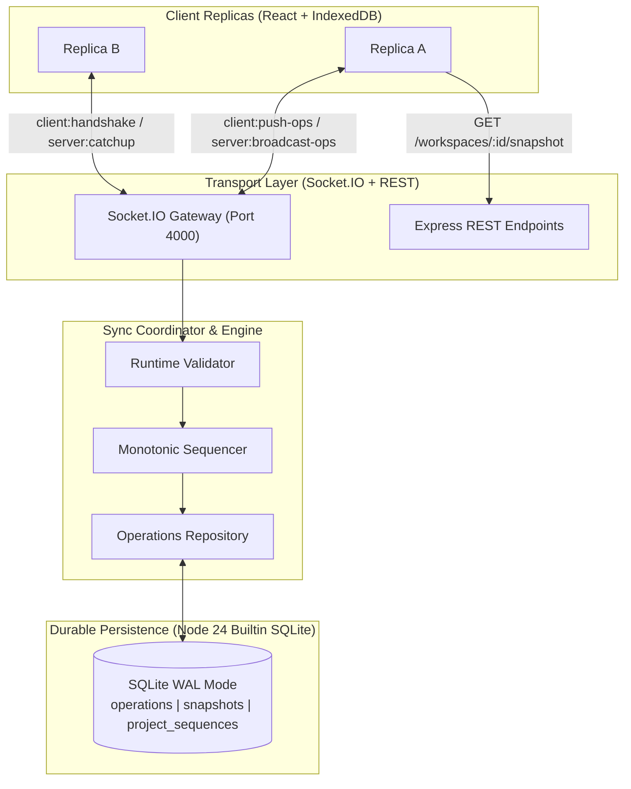
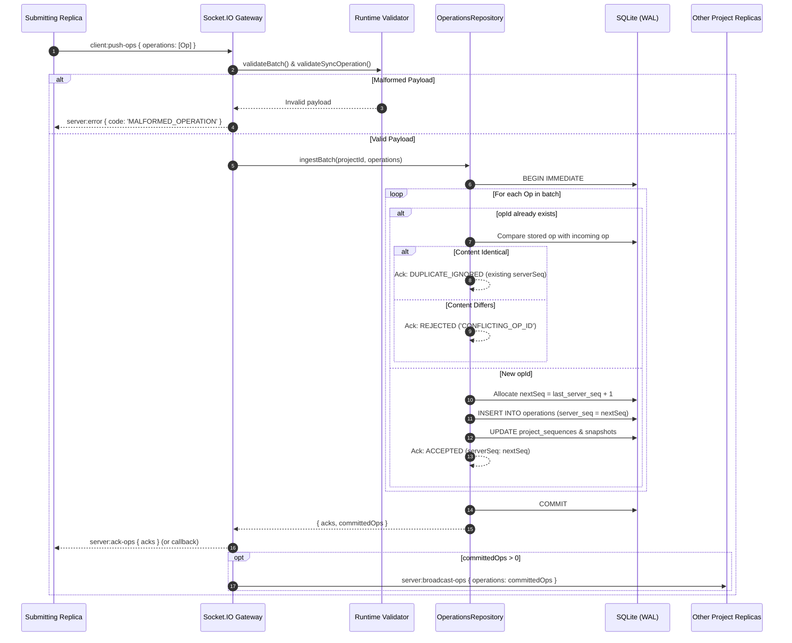

# NexusSync Architecture, Logic & Protocol Specification

**Tagline:** Prevent Conflicts. Protect Changes. Prove Consistency.  
**Version:** 0.3.0 (Step 3: Operation Ingestion & Synchronization Pipeline)  
**Status:** Authoritative Backend & Protocol Reference  
**Maintainers:** Antigravity Backend Engineer & ChatGPT Technical Lead  

---

## 1. Project Purpose & System Architecture

NexusSync is an offline-first, conflict-aware distributed collaboration engine built for real-time task management and multi-replica consistency. It provides:
1. **Local-First Availability:** Replicas mutate state locally without network blockages, persisting changes to IndexedDB.
2. **Causal Operation Ingestion:** Operations carry causal metadata (Vector Clocks and Lamport timestamps) to distinguish sequential edits from concurrent branches.
3. **Monotonic Total Ordering:** The server assigns monotonic sequence numbers (`serverSeq`) transactionally per workspace, enabling reliable delta replay and log catch-up.
4. **Idempotent Ingestion & Deduplication:** Guarantees that retried operations are never applied twice and detects conflicting `opId` reuse.
5. **Real-Time Convergence:** Propagates committed operations via room-scoped Socket.IO broadcasts and facilitates state catch-up on reconnection.



---

## 2. Repository Structure

```
bytex-coll/
├── .gitignore
├── eslint.config.js               # Frontend linter (ignores server/ and packages/)
├── package.json                   # Root orchestrator with convenience scripts
├── docs/
│   └── NEXUSSYNC_ARCHITECTURE_AND_LOGIC.md  # Canonical architecture document
├── packages/
│   └── shared/                    # @nexussync/shared (Universal Domain & Protocol)
│       ├── package.json
│       ├── tsconfig.json
│       ├── src/
│       │   ├── types.ts           # Domain models, TaskEntity, SyncOperation, ConflictRecord
│       │   ├── events.ts          # Socket.IO & REST contracts
│       │   ├── vector-clock.ts    # Vector clock comparison & merge utilities
│       │   ├── validation.ts      # Runtime validators & idempotency comparator
│       │   └── index.ts           # Barrel export
│       └── tests/
│           ├── vector-clock.test.ts (9 tests)
│           └── validation.test.ts   (7 tests)
├── server/                        # @nexussync/server (Express + Socket.IO + SQLite)
│   ├── package.json
│   ├── tsconfig.json
│   ├── src/
│   │   ├── config.ts              # Port, DB path, CORS origin
│   │   ├── db/
│   │   │   ├── database.ts        # Node 24 DatabaseSync connection & WAL mode
│   │   │   ├── schema.ts          # DDL tables & indexes
│   │   │   └── operations-repository.ts # Transactional ingestion & snapshot management
│   │   ├── middleware/
│   │   │   └── error-handler.ts   # Centralized JSON error middleware
│   │   ├── routes/
│   │   │   ├── health.ts          # GET /api/v1/health
│   │   │   └── workspace.ts       # GET /api/v1/workspaces/:projectId/snapshot
│   │   ├── sockets/
│   │   │   └── sync-handlers.ts   # Socket.IO handshake, push-ops, and broadcast handlers
│   │   └── server.ts              # Express + HTTP + Socket.IO bootstrap
│   └── tests/
│       ├── database.test.ts       (3 tests)
│       ├── health.test.ts         (2 tests)
│       ├── operations-repository.test.ts (7 tests)
│       ├── workspace-routes.test.ts (2 tests)
│       └── sync-pipeline.test.ts  (3 tests)
└── src/                           # React 19 Frontend (Owned by Frontend Developer)
```

---

## 3. Authoritative Shared Contracts (`packages/shared/`)

* **`TaskEntity` (`src/types.ts`):**  
  Fields: `id`, `projectId`, `title`, `description`, `status` (`TODO` | `IN_PROGRESS` | `REVIEW` | `DONE`), `priority` (`LOW` | `MEDIUM` | `HIGH` | `CRITICAL`), `dueDate`, `dependencies`, `version`, `updatedAt`, `isDeleted`.
* **`SyncOperation` (`src/types.ts`):**  
  Discriminated union on `type`: `TASK_CREATE`, `TASK_UPDATE_FIELD`, `TASK_DELETE`, `DEPENDENCY_ADD`, `DEPENDENCY_REMOVE`, `CONFLICT_RESOLVE`.  
  Carries `opId` (UUIDv4), `projectId`, `entityId`, `replicaId`, `clientSeq`, `serverSeq` (nullable prior to commit), `lamportTime`, `versionVector: Record<ReplicaId, number>`, `timestamp`, and typed `payload`.
* **`OperationAcknowledgement` (`src/types.ts`):**  
  `{ opId, serverSeq, status: 'ACCEPTED' | 'REJECTED' | 'DUPLICATE_IGNORED', reason? }`.
* **`SyncHandshake` & `SyncCatchup` (`src/types.ts`):**  
  Protocol packets for client connection and catch-up replay.
* **`ClientToServerEvents` & `ServerToClientEvents` (`src/events.ts`):**  
  Strict event maps for Socket.IO.

---

## 4. Database Schema & Persistence

Engineered using Node.js built-in `node:sqlite` (`DatabaseSync`) with `PRAGMA journal_mode = WAL;` and `PRAGMA foreign_keys = ON;`:

```sql
-- 1. Operations Log
CREATE TABLE IF NOT EXISTS operations (
  id INTEGER PRIMARY KEY AUTOINCREMENT,
  op_id TEXT NOT NULL UNIQUE,                -- Global idempotency key
  project_id TEXT NOT NULL,
  entity_id TEXT NOT NULL,
  type TEXT NOT NULL,
  payload TEXT NOT NULL,
  replica_id TEXT NOT NULL,
  client_seq INTEGER NOT NULL,
  server_seq INTEGER,                        -- Global commit order per project
  lamport_time INTEGER NOT NULL,
  version_vector TEXT NOT NULL,
  timestamp INTEGER NOT NULL,
  created_at DATETIME DEFAULT CURRENT_TIMESTAMP
);
CREATE INDEX idx_operations_project_server_seq ON operations(project_id, server_seq);
CREATE UNIQUE INDEX idx_operations_project_server_seq_unique ON operations(project_id, server_seq) WHERE server_seq IS NOT NULL;
CREATE INDEX idx_operations_op_id ON operations(op_id);
CREATE INDEX idx_operations_entity ON operations(project_id, entity_id);

-- 2. Monotonic Sequence Allocation
CREATE TABLE IF NOT EXISTS project_sequences (
  project_id TEXT PRIMARY KEY,
  last_server_seq INTEGER NOT NULL DEFAULT 0,
  updated_at DATETIME DEFAULT CURRENT_TIMESTAMP
);

-- 3. Document Snapshots Cache
CREATE TABLE IF NOT EXISTS document_snapshots (
  project_id TEXT PRIMARY KEY,
  server_seq INTEGER NOT NULL DEFAULT 0,
  version_vector TEXT NOT NULL DEFAULT '{}',
  snapshot_data TEXT NOT NULL DEFAULT '{}',
  updated_at DATETIME DEFAULT CURRENT_TIMESTAMP
);

-- 4. Conflicts Registry
CREATE TABLE IF NOT EXISTS conflicts (
  conflict_id TEXT PRIMARY KEY,
  project_id TEXT NOT NULL,
  entity_id TEXT NOT NULL,
  field TEXT,
  type TEXT NOT NULL,
  status TEXT NOT NULL DEFAULT 'UNRESOLVED',
  branch_a TEXT NOT NULL,
  branch_b TEXT NOT NULL,
  suggested_resolution TEXT,
  winning_value TEXT,
  resolved_by TEXT,
  resolved_at TEXT,
  created_at DATETIME DEFAULT CURRENT_TIMESTAMP
);
CREATE INDEX idx_conflicts_project_status ON conflicts(project_id, status);

-- 5. Resolution Memory
CREATE TABLE IF NOT EXISTS resolution_memory (
  id TEXT PRIMARY KEY,
  pattern_hash TEXT NOT NULL UNIQUE,
  conflict_type TEXT NOT NULL,
  field TEXT NOT NULL,
  chosen_pattern TEXT NOT NULL,
  resolution_data TEXT NOT NULL,
  times_applied INTEGER NOT NULL DEFAULT 1,
  last_used DATETIME DEFAULT CURRENT_TIMESTAMP
);
```

---

## 5. Operation Lifecycle



---

## 6. Handshake & Catch-Up Lifecycle

1. **Client Connects:** Emits `client:handshake` with `{ replicaId, projectId, knownVector, lastServerSeq }`.
2. **Validation & Authorization:** Handshake payload is validated. The socket joins room `project:${projectId}`.
3. **Catch-Up Query:** The server queries `operations` where `project_id = ? AND server_seq > lastServerSeq ORDER BY server_seq ASC LIMIT 100`.
4. **Deterministic Response:** Emits `server:catchup` (and executes callback if supplied):
   * `currentServerSeq`: Highest assigned sequence for the project.
   * `currentVector`: Component-wise maximum of client sequences known by server.
   * `missedOps`: Ordered list of committed operations missed by the client.
   * `unresolvedConflicts`: Active unresolved conflicts for the project.

---

## 7. Sequence Allocation & Idempotency Rules

* **Monotonicity:** `serverSeq` is guaranteed to be strictly sequential ($1, 2, 3, \dots$) within each `projectId`. Different projects maintain completely independent sequence counters.
* **Concurrency Lock:** `BEGIN IMMEDIATE` ensures that concurrent requests serialize at write-time, preventing sequence collision or gaps.
* **Idempotency Rule:**
  * Submitting an op with an existing `opId` whose fields match the stored operation returns `DUPLICATE_IGNORED` and the original `serverSeq`. The sequence counter is **not** incremented, and no broadcast is emitted.
* **Conflict Guard:**
  * Submitting an op with an existing `opId` but different content returns `REJECTED` (`CONFLICTING_OP_ID`).

---

## 8. Real-Time Broadcast Semantics

* **Scoped:** Broadcasts are strictly emitted to `project:${projectId}`. Replicas in `project:A` never receive broadcasts from `project:B`.
* **Sender Excluded:** Broadcasts are dispatched via `socket.to(room).emit('server:broadcast-ops', ...)`. The submitting client receives acknowledgement via `acks` and does not receive a duplicate broadcast echo.
* **Committed-Only:** Broadcast occurs **only after** the SQLite transaction commits successfully.

---

## 9. REST Routes & Response Contracts

### `GET /api/v1/health`
Returns truthful system status, Node.js uptime, and SQLite WAL connectivity.
```json
{
  "status": "healthy",
  "service": "NexusSync Sync Coordinator",
  "version": "0.1.0",
  "uptime": 45,
  "timestamp": "2026-10-10T05:20:00.000Z",
  "db": { "connected": true, "walMode": true },
  "serverSeq": 0
}
```

### `GET /api/v1/workspaces/:projectId/snapshot`
Returns the workspace snapshot, active tasks, and unresolved conflicts.
```json
{
  "success": true,
  "data": {
    "projectId": "proj-collab",
    "serverSeq": 2,
    "versionVector": { "client-1": 2 },
    "tasks": [
      {
        "id": "task-101",
        "projectId": "proj-collab",
        "title": "Build Architecture Document",
        "description": "Document sync pipeline and sequence allocation",
        "status": "IN_PROGRESS",
        "priority": "HIGH",
        "dueDate": null,
        "dependencies": [],
        "version": 2,
        "updatedAt": "2026-10-10T05:22:00.000Z",
        "isDeleted": false
      }
    ],
    "unresolvedConflicts": []
  }
}
```

---

## 10. Security Assumptions & Prototype Limitations

1. **Authentication:** The prototype currently trusts client-supplied `replicaId` and `projectId`. True production JWT or session authentication is deferred to post-hackathon phases.
2. **Batch Limits:** Maximum batch size is restricted to 50 operations (`MAX_BATCH_SIZE = 50`) and individual operation JSON size to 64KB (`MAX_PAYLOAD_BYTES = 65536`).
3. **Network Delivery:** Socket.IO does not guarantee exactly-once network transport; durability is guaranteed by the SQLite operation log and the catch-up mechanism.

---

## 11. Test Coverage & Verification Results

* Command executed: `npm run test:all`
* **Test Suites:** 7 test files, **33 tests passed (0 failures)**.
  * `@nexussync/shared`:
    * `tests/vector-clock.test.ts` (9 tests passed)
    * `tests/validation.test.ts` (7 tests passed)
  * `@nexussync/server`:
    * `tests/database.test.ts` (3 tests passed)
    * `tests/health.test.ts` (2 tests passed)
    * `tests/operations-repository.test.ts` (7 tests passed)
    * `tests/workspace-routes.test.ts` (2 tests passed)
    * `tests/sync-pipeline.test.ts` (3 tests passed)

---

## 12. Exact Next Recommended Backend Phase (Step 4)

**Step 4: Semantic Conflict Detection & DAG Invariant Engine**
1. Integrate vector clock comparison ($V_A \parallel V_B$) during operation ingestion to detect concurrent field collisions.
2. Implement DAG cycle detection to prevent cyclic task dependencies.
3. Move concurrent collisions into quarantined status (`conflicts` table) and broadcast `server:conflict-detected`.
4. Implement manual resolution endpoint / handler (`client:resolve-conflict`).
