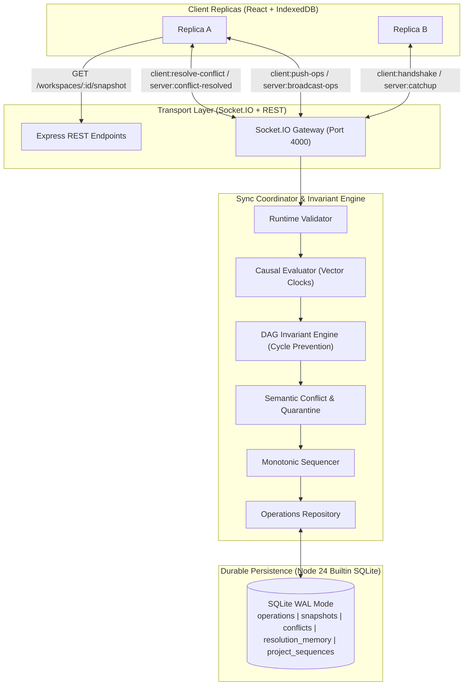
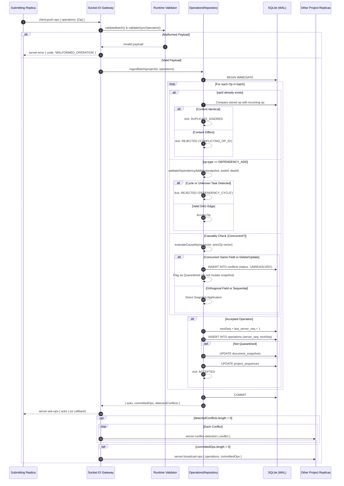

# NexusSync Architecture, Logic & Protocol Specification

**Tagline:** Prevent Conflicts. Protect Changes. Prove Consistency.  
**Version:** 0.4.0 (Step 4: Semantic Conflict Detection & DAG Invariant Engine)  
**Status:** Authoritative Backend & Protocol Reference  
**Maintainers:** Antigravity Backend Engineer & ChatGPT Technical Lead  

---

## 1. Project Purpose & System Architecture

NexusSync is an offline-first, conflict-aware distributed collaboration engine built for real-time task management and multi-replica consistency. It provides:
1. **Local-First Availability:** Replicas mutate state locally without network blockages, persisting changes to IndexedDB.
2. **Causal Concurrency & Vector Clocks:** Operations carry causal metadata (Vector Clocks and Lamport timestamps) component-wise evaluated to differentiate sequential mutations from concurrent branches.
3. **Task Dependency DAG Invariant Engine:** Enforces that task dependencies remain a strict Directed Acyclic Graph (DAG), preventing directed cycles and self-dependencies.
4. **Semantic Conflict Detection & Quarantine:** Identifies scalar field collisions and delete/update collisions between concurrent operations, quarantines conflicting branches, and preserves deterministic snapshot state until resolution.
5. **Orthogonal Field-Level Auto-Merge:** Deterministically merges concurrent edits touching disjoint task fields without artificial conflict creation.
6. **Manual Conflict Resolution Protocol:** Provides transactional conflict resolution, immutable `CONFLICT_RESOLVE` log entries, sequence allocation, peer broadcast, and resolution memory persistence.
7. **Monotonic Total Ordering & Idempotency:** The server assigns monotonic sequence numbers (`serverSeq`) transactionally per workspace, deduplicating identical retries and rejecting conflicting `opId` reuse.



---

## 2. Repository Structure

```
bytex-coll/
├── .gitignore
├── eslint.config.js               # Frontend linter (ignores server/ and packages/)
├── package.json                   # Root orchestrator with test:all, server:build, etc.
├── docs/
│   └── NEXUSSYNC_ARCHITECTURE_AND_LOGIC.md  # Canonical architecture document
├── packages/
│   └── shared/                    # @nexussync/shared (Universal Domain & Protocol)
│       ├── package.json
│       ├── tsconfig.json
│       ├── src/
│       │   ├── types.ts           # Domain models, TaskEntity, SyncOperation, ConflictRecord
│       │   ├── events.ts          # Socket.IO & REST contracts
│       │   ├── vector-clock.ts    # evaluateCausality (BEFORE/AFTER/EQUAL/CONCURRENT), validateVectorStrict
│       │   ├── dag.ts             # detectCycleInTasks, validateDependencyAddition, isGraphGloballyAcyclic
│       │   ├── validation.ts      # Runtime validators, batch limits, and resolution validation
│       │   └── index.ts           # Barrel export
│       └── tests/
│           ├── vector-clock.test.ts (10 tests)
│           ├── dag.test.ts          (7 tests)
│           └── validation.test.ts   (8 tests)
├── server/                        # @nexussync/server (Express + Socket.IO + SQLite)
│   ├── package.json
│   ├── tsconfig.json
│   ├── src/
│   │   ├── config.ts              # Port, DB path, CORS origin
│   │   ├── db/
│   │   │   ├── database.ts        # Node 24 DatabaseSync connection & WAL mode
│   │   │   ├── schema.ts          # DDL tables & indexes
│   │   │   └── operations-repository.ts # Ingestion, DAG validation, conflict quarantine, resolution
│   │   ├── middleware/
│   │   │   └── error-handler.ts   # Centralized JSON error middleware
│   │   ├── routes/
│   │   │   ├── health.ts          # GET /api/v1/health
│   │   │   └── workspace.ts       # GET /api/v1/workspaces/:projectId/snapshot
│   │   ├── sockets/
│   │   │   └── sync-handlers.ts   # Socket.IO handshake, push-ops, resolve-conflict handlers
│   │   └── server.ts              # Express + HTTP + Socket.IO bootstrap
│   └── tests/
│       ├── database.test.ts       (3 tests)
│       ├── health.test.ts         (2 tests)
│       ├── operations-repository.test.ts (7 tests)
│       ├── workspace-routes.test.ts (2 tests)
│       ├── sync-pipeline.test.ts  (4 tests)
│       └── semantic-conflicts-and-dag.test.ts (15 tests)
└── src/                           # React 19 Frontend (Owned by Frontend Developer)
```

---

## 3. Causal Ordering & Vector-Clock Evaluation

NexusSync rejects wall-clock timestamps and client sequence numbers as causal proof. Causality is strictly determined component-wise using vector clocks (`VersionVector = Record<ReplicaId, number>`).

### A. Four-Way Causal Evaluation (`evaluateCausality(v1, v2)`)
Given two vectors $V_1$ and $V_2$:
- **`EQUAL` ($V_1 = V_2$):** $\forall k, V_1[k] = V_2[k]$.
- **`AFTER` ($V_1 > V_2$):** $\forall k, V_1[k] \ge V_2[k]$ and $\exists k, V_1[k] > V_2[k]$. $V_1$ causally follows $V_2$.
- **`BEFORE` ($V_1 < V_2$):** $\forall k, V_1[k] \le V_2[k]$ and $\exists k, V_1[k] < V_2[k]$. $V_1$ causally precedes $V_2$.
- **`CONCURRENT` ($V_1 \parallel V_2$):** $\exists i, V_1[i] > V_2[i]$ AND $\exists j, V_2[j] > V_1[j]$. Neither causally precedes the other; mutations were performed in parallel.

### B. Strict Validation & Missing Replica Entries
- `validateVectorStrict(v)` enforces that every replica counter is a finite, non-negative integer ($\ge 0$). Malformed or negative values throw an error and reject the operation.
- Absent components are treated consistently as $0$ ($V[k] ?? 0$).
- Client-supplied `serverSeq` is untrusted on ingress and overwritten with authoritative server sequence allocation.

---

## 4. Task Dependency DAG Invariant Engine

The dependency graph between tasks must remain a Directed Acyclic Graph (DAG) at all times. A directed edge $A \rightarrow B$ indicates that task $A$ depends on prerequisite task $B$.

### A. Cycle Detection Algorithm
1. **Self-Dependency Check:** $A \rightarrow A$ is forbidden ($O(1)$).
2. **Path Reachability Check:** When adding edge $A \rightarrow B$, a cycle is formed if and only if there is already an existing path from $B$ to $A$ ($B \rightsquigarrow A$).
3. **Algorithm:** BFS/DFS traversal beginning at target $B$ traversing outgoing prerequisite edges in the active task graph.
4. **Complexity:** Time complexity $O(V + E)$ where $V \le \text{task count}$ and $E \le \text{dependency count}$. Space complexity $O(V)$ for visited tracking.
5. **Global Invariant Check (Kahn's Algorithm):** `isGraphGloballyAcyclic(tasks)` calculates in-degrees across all active tasks and computes topological ordering to guarantee global acyclicity across arbitrary batch or resolution states.

### B. Transactional Invariant Enforcement
All DAG validations occur inside `runTransaction` (`BEGIN IMMEDIATE` in SQLite). If an incoming `DEPENDENCY_ADD` would create a directed cycle, refer to an unknown task, or reference a deleted task:
- The operation is **REJECTED** with structured ack: `{ status: 'REJECTED', reason: 'INVARIANT_VIOLATION: DEPENDENCY_CYCLE' }`.
- The snapshot is **not** mutated.
- The operation is **not** broadcast.

---

## 5. Semantic Conflict Detection & Quarantine Lifecycle

When two operations affecting the same task are evaluated as `CONCURRENT` ($V_1 \parallel V_2$):

### A. Causally Ordered Updates
If $V_{incoming}$ causally follows $V_{previous}$ (`AFTER`), the update is accepted and applied sequentially. No conflict is flagged.

### B. Orthogonal Field-Level Auto-Merge
If two concurrent operations modify independent fields of the same task (e.g. Replica A updates `priority` while Replica B updates `title`):
- Both operations are committed to the operation log.
- Both updates are applied to the snapshot, preserving both valid user modifications deterministically.
- No artificial conflict is created.

### C. Concurrent Same-Field Collision (`CONCURRENT_FIELD_COLLISION`)
If two concurrent operations modify the same scalar field (e.g. `status` or `priority`) with different values:
- A durable conflict record is inserted into the `conflicts` table (`status = 'UNRESOLVED'`).
- Both competing branches (`branchA` and `branchB`) are preserved along with their `replicaId`, `opId`, `value`, and `timestamp`.
- The conflicting value is **quarantined**: it is NOT applied to the authoritative task snapshot as a silent winner.
- The second operation is logged in the operation log, but snapshot state remains in its deterministic pre-collision state.
- `server:conflict-detected` is broadcast to the project room.

### D. Delete/Update Collision (`DELETE_UPDATE_COLLISION`)
If one replica deletes a task while another concurrent replica updates a field:
- A conflict record of type `DELETE_UPDATE_COLLISION` is created.
- The task is not silently resurrected or discarded.
- State is quarantined pending user review.

---

## 6. Manual Conflict Resolution Protocol

Clients resolve unresolved conflicts by emitting `client:resolve-conflict`.

### A. Validation & Safeguards
1. Validates payload via `validateConflictResolutionPayload`.
2. Validates `conflictId`, `entityId`, and project scope in SQLite.
3. Ensures conflict exists and `status === 'UNRESOLVED'`.
4. Enforces idempotency: if already resolved, returns `ACCEPTED` with existing sequence.
5. Simulates resolution against workspace snapshot tasks and validates global DAG acyclicity via `isGraphGloballyAcyclic`.

### B. Transactional Commit Lifecycle
Within a single `BEGIN IMMEDIATE` transaction:
1. Allocates next monotonic `serverSeq`.
2. Records an immutable `CONFLICT_RESOLVE` operation in `operations`.
3. Updates `document_snapshots` with `resolvedFields` and increments task version.
4. Updates `conflicts` table: sets `status = 'RESOLVED'`, `winning_value`, `resolved_by`, and `resolved_at`.
5. If `rememberDecision: true`, persists the pattern hash into `resolution_memory`.
6. Commits transaction.

### C. Post-Commit Broadcast
Only after the transaction commits:
- Acknowledges submitter via callback: `{ ack: { status: 'ACCEPTED', serverSeq } }`.
- Emits `server:conflict-resolved` with `{ conflictId, resolutionOp }` to `project:${projectId}`.
- Broadcasts `resolutionOp` via `server:broadcast-ops` to room peers.

---

## 7. Operation Lifecycle Diagram



---

## 8. Database Schema & Persistence

Engineered using Node.js built-in `node:sqlite` (`DatabaseSync`) with WAL mode (`PRAGMA journal_mode = WAL;`) and foreign keys:

```sql
-- 1. Operations Log (Immutable Append-Only Log)
CREATE TABLE IF NOT EXISTS operations (
  id INTEGER PRIMARY KEY AUTOINCREMENT,
  op_id TEXT NOT NULL UNIQUE,                -- Global idempotency key
  project_id TEXT NOT NULL,
  entity_id TEXT NOT NULL,
  type TEXT NOT NULL,
  payload TEXT NOT NULL,
  replica_id TEXT NOT NULL,
  client_seq INTEGER NOT NULL,
  server_seq INTEGER,                        -- Global commit order per project
  lamport_time INTEGER NOT NULL,
  version_vector TEXT NOT NULL,
  timestamp INTEGER NOT NULL,
  created_at DATETIME DEFAULT CURRENT_TIMESTAMP
);
CREATE INDEX idx_operations_project_server_seq ON operations(project_id, server_seq);
CREATE UNIQUE INDEX idx_operations_project_server_seq_unique ON operations(project_id, server_seq) WHERE server_seq IS NOT NULL;
CREATE INDEX idx_operations_op_id ON operations(op_id);
CREATE INDEX idx_operations_entity ON operations(project_id, entity_id);

-- 2. Monotonic Sequence Allocation
CREATE TABLE IF NOT EXISTS project_sequences (
  project_id TEXT PRIMARY KEY,
  last_server_seq INTEGER NOT NULL DEFAULT 0,
  updated_at DATETIME DEFAULT CURRENT_TIMESTAMP
);

-- 3. Document Snapshots Cache
CREATE TABLE IF NOT EXISTS document_snapshots (
  project_id TEXT PRIMARY KEY,
  server_seq INTEGER NOT NULL DEFAULT 0,
  version_vector TEXT NOT NULL DEFAULT '{}',
  snapshot_data TEXT NOT NULL DEFAULT '{}',
  updated_at DATETIME DEFAULT CURRENT_TIMESTAMP
);

-- 4. Conflicts Registry (Quarantined Branches)
CREATE TABLE IF NOT EXISTS conflicts (
  conflict_id TEXT PRIMARY KEY,
  project_id TEXT NOT NULL,
  entity_id TEXT NOT NULL,
  field TEXT,
  type TEXT NOT NULL,
  status TEXT NOT NULL DEFAULT 'UNRESOLVED',
  branch_a TEXT NOT NULL,
  branch_b TEXT NOT NULL,
  suggested_resolution TEXT,
  winning_value TEXT,
  resolved_by TEXT,
  resolved_at TEXT,
  created_at DATETIME DEFAULT CURRENT_TIMESTAMP
);
CREATE INDEX idx_conflicts_project_status ON conflicts(project_id, status);

-- 5. Resolution Memory (Learned Conflict Resolution Patterns)
CREATE TABLE IF NOT EXISTS resolution_memory (
  id TEXT PRIMARY KEY,
  pattern_hash TEXT NOT NULL UNIQUE,
  conflict_type TEXT NOT NULL,
  field TEXT NOT NULL,
  chosen_pattern TEXT NOT NULL,
  resolution_data TEXT NOT NULL,
  times_applied INTEGER NOT NULL DEFAULT 1,
  last_used DATETIME DEFAULT CURRENT_TIMESTAMP
);
```

---

## 9. Security Assumptions & Prototype Limitations

1. **Authentication:** The prototype currently trusts client-supplied `replicaId` and `projectId`. Production JWT/session authentication is scheduled for post-hackathon phases.
2. **Batch Limits:** Maximum batch size is restricted to 50 operations (`MAX_BATCH_SIZE = 50`) and individual operation JSON size to 64KB (`MAX_PAYLOAD_BYTES = 65536`).
3. **Resolution Memory Automation:** While pattern hashes are stored upon manual resolution when `rememberDecision = true`, automatic auto-application without human supervision is disabled in Step 4 to ensure deterministic safety.

---

## 10. Test Coverage & Verification Results

* Command executed: `npm run test:all`
* **Test Suites:** 9 test files, **58 tests passed (0 failures)**.
  * `@nexussync/shared`:
    * `tests/vector-clock.test.ts` (10 tests passed)
    * `tests/dag.test.ts` (7 tests passed)
    * `tests/validation.test.ts` (8 tests passed)
  * `@nexussync/server`:
    * `tests/semantic-conflicts-and-dag.test.ts` (15 tests passed)
    * `tests/database.test.ts` (3 tests passed)
    * `tests/health.test.ts` (2 tests passed)
    * `tests/operations-repository.test.ts` (7 tests passed)
    * `tests/workspace-routes.test.ts` (2 tests passed)
    * `tests/sync-pipeline.test.ts` (4 tests passed)

* **Build & Typecheck:**
  * Shared package typecheck: `npm run typecheck` (`tsc --noEmit`) passed.
  * Server compilation: `npm run server:build` (`tsc`) passed with 0 errors.
  * Root linter: `npm run lint` (`eslint .`) passed with 0 warnings/errors.
  * Root frontend build: `npm run build` (`vite build`) passed.

---

## 11. Outstanding Frontend Integration Questions

1. **Conflict Quarantine UI:** When `server:conflict-detected` is received, how will the frontend visually render the quarantined state? (Recommended: A split-diff card highlighting branch A and branch B with resolution actions: Choose A, Choose B, Custom Merge).
2. **DAG Cycle Toast:** When a client attempts to add a dependency that is rejected with `INVARIANT_VIOLATION: DEPENDENCY_CYCLE`, how should the user be alerted? (Recommended: An inline error tooltip on the dependency selector).
3. **Resolution Memory Opt-In:** Will the resolution modal feature a checkbox `"Remember this resolution for similar conflicts"` to populate `rememberDecision: boolean`?

---

## 12. Recommended Next Backend Phase (Step 5)

**Step 5: Network Fault Injection, Offline Simulation & Convergence Verification**
1. Implement a configurable network fault simulator in backend test harness (latency, jitter, packet drop, partitioned disconnects).
2. Automated multi-replica offline desynchronization and reconvergence stress testing.
3. Verification of state equivalence across all participating nodes after randomized network partitions heal.
