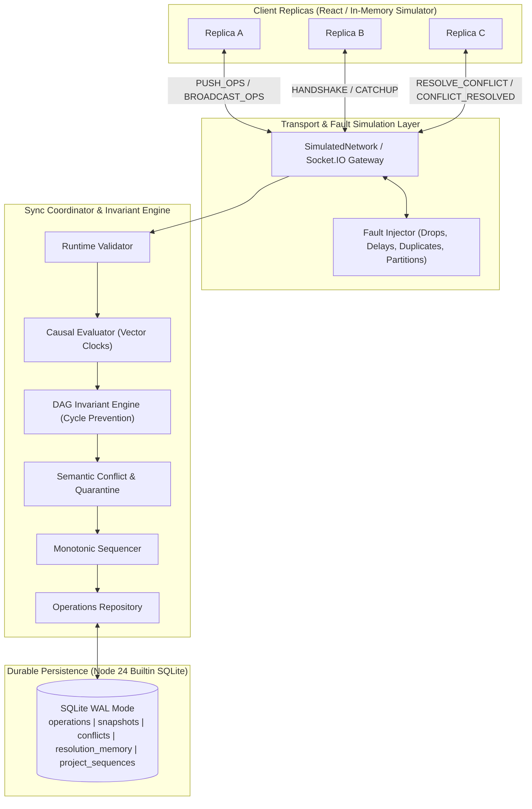

# NexusSync Architecture, Logic & Protocol Specification

**Tagline:** Prevent Conflicts. Protect Changes. Prove Consistency.  
**Version:** 0.5.0 (Step 5: Network Fault Simulator, Partition Recovery & Convergence Testing)  
**Status:** Authoritative Backend & Protocol Reference  
**Maintainers:** Antigravity Backend Engineer & ChatGPT Technical Lead  

---

## 1. Project Purpose & System Architecture

NexusSync is an offline-first, conflict-aware distributed collaboration engine built for real-time task management and multi-replica consistency. It provides:
1. **Local-First Availability:** Replicas mutate state locally without network blockages, persisting changes locally.
2. **Causal Concurrency & Vector Clocks:** Operations carry causal metadata (Vector Clocks and Lamport timestamps) component-wise evaluated to differentiate sequential mutations from concurrent branches.
3. **Task Dependency DAG Invariant Engine:** Enforces that task dependencies remain a strict Directed Acyclic Graph (DAG), preventing directed cycles and self-dependencies.
4. **Semantic Conflict Detection & Quarantine:** Identifies scalar field collisions and delete/update collisions between concurrent operations, quarantines conflicting branches, and preserves deterministic snapshot state until resolution.
5. **Orthogonal Field-Level Auto-Merge:** Deterministically merges concurrent edits touching disjoint task fields without artificial conflict creation.
6. **Manual Conflict Resolution Protocol:** Provides transactional conflict resolution, immutable `CONFLICT_RESOLVE` log entries, sequence allocation, peer broadcast, and resolution memory persistence.
7. **Monotonic Total Ordering & Idempotency:** The server assigns monotonic sequence numbers (`serverSeq`) transactionally per workspace, deduplicating identical retries and rejecting conflicting `opId` reuse.
8. **Deterministic Network Fault Simulation & Convergence Verification:** Includes a reproducible, seeded discrete-event simulation harness verifying convergence under network latency, packet drops, duplicate delivery, reordering, and arbitrary network partitions.



---

## 2. Repository Structure

```
bytex-coll/
├── .gitignore
├── eslint.config.js               # Frontend linter (ignores server/ and packages/)
├── package.json                   # Root orchestrator with test:all, server:build, etc.
├── docs/
│   └── NEXUSSYNC_ARCHITECTURE_AND_LOGIC.md  # Canonical architecture document
├── packages/
│   └── shared/                    # @nexussync/shared (Universal Domain & Protocol)
│       ├── package.json
│       ├── tsconfig.json
│       ├── src/
│       │   ├── types.ts           # Domain models, TaskEntity, SyncOperation, ConflictRecord
│       │   ├── events.ts          # Socket.IO & REST contracts
│       │   ├── vector-clock.ts    # evaluateCausality (BEFORE/AFTER/EQUAL/CONCURRENT), validateVectorStrict
│       │   ├── dag.ts             # detectCycleInTasks, validateDependencyAddition, isGraphGloballyAcyclic
│       │   ├── validation.ts      # Runtime validators, batch limits, and resolution validation
│       │   └── index.ts           # Barrel export
│       └── tests/
│           ├── vector-clock.test.ts (10 tests)
│           ├── dag.test.ts          (7 tests)
│           └── validation.test.ts   (8 tests)
├── server/                        # @nexussync/server (Express + Socket.IO + SQLite)
│   ├── package.json
│   ├── tsconfig.json
│   ├── src/
│   │   ├── config.ts              # Port, DB path, CORS origin
│   │   ├── db/
│   │   │   ├── database.ts        # Node 24 DatabaseSync connection & WAL mode
│   │   │   ├── schema.ts          # DDL tables & indexes
│   │   │   └── operations-repository.ts # Ingestion, DAG validation, conflict quarantine, resolution
│   │   ├── middleware/
│   │   │   └── error-handler.ts   # Centralized JSON error middleware
│   │   ├── routes/
│   │   │   ├── health.ts          # GET /api/v1/health
│   │   │   └── workspace.ts       # GET /api/v1/workspaces/:projectId/snapshot
│   │   ├── sockets/
│   │   │   └── sync-handlers.ts   # Socket.IO handshake, push-ops, resolve-conflict handlers
│   │   └── server.ts              # Express + HTTP + Socket.IO bootstrap
│   └── tests/
│       ├── simulation/            # Deterministic Network Fault & Convergence Harness
│       │   ├── seeded-random.ts       # Mulberry32 reproducible PRNG
│       │   ├── simulated-network.ts   # Discrete-event packet scheduler with fault injection
│       │   ├── simulated-replica.ts   # Local-first client node with contiguous gap detection
│       │   ├── simulation-harness.ts  # End-to-end integration between DB, repo, network & replicas
│       │   └── convergence-invariants.ts # Formal verifier for all 10 convergence invariants
│       ├── network-fault-scenarios.test.ts   (7 tests: Scenarios A through G)
│       ├── network-stress-randomized.test.ts (2 tests: Multi-seed pseudo-random stress suite)
│       ├── semantic-conflicts-and-dag.test.ts (15 tests)
│       ├── operations-repository.test.ts      (7 tests)
│       ├── sync-pipeline.test.ts              (4 tests)
│       ├── workspace-routes.test.ts           (2 tests)
│       ├── health.test.ts                     (2 tests)
│       └── database.test.ts                   (3 tests)
└── src/                           # React 19 Frontend (Owned by Frontend Developer)
```

---

## 3. Deterministic Network Fault Simulator Architecture

The test harness provides a discrete-event network simulator (`SimulatedNetwork`) operating on discrete virtual clock ticks without relying on wall-clock `sleep()`:

### A. Supported Fault Models
1. **Packet Drops (`dropRate`):** Simulates lost IP/WebSocket packets. Dropped packets are counted in metrics and never delivered.
2. **Duplicate Packets (`duplicateRate`):** Duplicates messages with random delay offsets to test `opId` idempotency and client duplicate-rejection.
3. **Reordering Jitter (`reorderRate`):** Randomly jitters delivery ticks so later messages arrive before earlier messages.
4. **Arbitrary Network Partitions (`partition(groups)`):** Partitions nodes into disjoint network sets (e.g., `{ReplicaA}` vs `{ReplicaB, ReplicaC, Server}`). Communication between different partition groups drops until `healPartitions()` is called.
5. **Replica Disconnections (`disconnect(nodeId)` / `reconnect(nodeId)`):** Simulates offline mobile/desktop clients losing internet connectivity.
6. **Reproducible PRNG (`SeededRandom`):** Uses Mulberry32 with recorded seeds so any failing test case can be deterministically reproduced.

### B. Broadcast Sequence Gap Detection
To prevent client replicas from permanently missing operations when offline or when broadcast packets are dropped:
- A replica only advances its `lastServerSeq` upon receiving a broadcast if the operation is **strictly contiguous** ($op.serverSeq === lastServerSeq + 1$).
- If $op.serverSeq > lastServerSeq + 1$ (indicating a gap in the broadcast stream), the replica applies the operation but preserves its low-water mark `lastServerSeq`.
- When the replica reconnects or catches up via `requestCatchup()`, the server returns all missed operations starting from the low-water mark `lastServerSeq`, completely filling the gap.

---

## 4. Replica & Partition Scenarios (Step 5 Test Suite)

Implemented in `server/tests/network-fault-scenarios.test.ts`:

- **Scenario A (Normal Synchronization):** 3 replicas (A, B, C) perform sequential and concurrent mutations. Verified that operations are durably committed, sequences are monotonic, and room broadcasts converge all nodes.
- **Scenario B (Offline Partition & Reconnect):** Replica A is partitioned while B & C make progress. A enqueues local pending operations offline. Upon partition healing, A flushes pending ops, catches up, and all 3 replicas achieve 100% state equivalence.
- **Scenario C (Duplicate & Reordered Messages):** Injects 50% duplicate delivery and 50% reordering jitter. Verified that duplicate `opId` submissions return `DUPLICATE_IGNORED` without advancing sequence counters, conflicting `opId` reuse is rejected, and out-of-order mutations converge.
- **Scenario D (Concurrent Same-Field Collision):** Partitions A and B; both modify the same scalar field from a shared baseline. After reconnect, verified durable quarantine of both branches in `conflicts`, non-pollution of snapshot, manual conflict resolution via `MERGE_CUSTOM`, and convergence.
- **Scenario E (Orthogonal Edits):** Partitions A and B; A mutates `priority` while B mutates `title`. After reconnect, verified deterministic field-level merge preserves both valid changes without creating false conflicts.
- **Scenario F (Dependency Cycles Under Partition):** Concurrent dependency additions under partition ($A \rightarrow B$ and $B \rightarrow A$). Verified cycle detection rejects the second addition, snapshot graph remains strictly acyclic, and rejected ops are not broadcast.
- **Scenario G (Partition Recovery with Conflict Resolution):** A conflict is generated and resolved while Replica A is offline. Upon reconnect, A requests catch-up, receives the `CONFLICT_RESOLVE` log entry, clears unresolved conflict badges, and converges to the resolved state.

---

## 5. Convergence Definition & Invariants

### A. Definition of Convergence
Two replicas are defined as **converged** if and only if:
1. Both replicas have processed all committed server operations up to the server's highest sequence number ($lastServerSeq = highestServerSeq$).
2. Both replicas have zero pending unacknowledged operations ($pendingQueue.length = 0$).
3. The projected active task models on both replicas are identical in active count, attributes (`title`, `status`, `priority`, `dueDate`), and dependencies.

Replicas with unacknowledged local mutations or un-resolved conflicts are quarantined and explicitly distinguished from converged state.

### B. The 10 Formally Verified Invariants
Checked by `ConvergenceInvariantChecker.runAll(harness, replicas)`:
1. **Operation Durability:** Every operation acknowledged as `ACCEPTED` exists in the SQLite `operations` table with non-null `server_seq`.
2. **Idempotency:** Replaying an identical operation returns `DUPLICATE_IGNORED` without incrementing sequence numbers or duplicating log rows.
3. **Sequence Integrity:** `server_seq` within a project is strictly monotonic ($1, 2, 3, \dots, N$) with zero gaps and zero duplicates.
4. **Conflict Preservation:** All unresolved conflicts retain both competing branches with replica IDs, operation IDs, values, and timestamps.
5. **DAG Safety:** Authoritative task snapshots are verified globally acyclic via Kahn's algorithm (`isGraphGloballyAcyclic`).
6. **Resolution Consistency:** Resolved conflicts produce durable `CONFLICT_RESOLVE` operations and winning values in SQLite.
7. **Recovery Completeness:** Replicas that complete catch-up reach $lastServerSeq = highestServerSeq$.
8. **Deterministic Replay:** Reconstructing the task map from scratch by sequentially reducing all operations in `server_seq ASC` order produces the identical state as the cached snapshot.
9. **Partition Recovery:** Reconnected replicas flush their offline queues to zero pending operations.
10. **State Convergence:** All active tasks on all caught-up replicas match the server authoritative snapshot identically.

---

## 6. Multi-Seed Randomized Stress Suite

Implemented in `server/tests/network-stress-randomized.test.ts`:
- **Configuration:** 4 replicas, 40 pseudo-random rounds per seed under active network faults (8% drops, 12% duplicates, 15% reordering jitter).
- **Randomized Actions:** Random task creation, field updates, dependency additions, random network cuts, partition healing, node disconnects, and catch-up triggers.
- **Seeds Tested:** `seed = 98765`, `seed = 54321`.
- **Results:** 100% convergence across all seeds; all 10 invariants passed without failure.

---

## 7. Simulated vs Production Implementation Boundaries

| Feature | Production Code (`server/src/`, `packages/shared/`) | Simulation Test Harness (`server/tests/simulation/`) |
| :--- | :--- | :--- |
| **Operation Log Persistence** | Durable Node 24 `node:sqlite` in WAL mode | Tested using in-memory SQLite (`:memory:`) |
| **Monotonic Sequencing** | Transactional `BEGIN IMMEDIATE` sequencer | Tested under concurrent load & retries |
| **Causal Evaluation** | `evaluateCausality` in `@nexussync/shared` | Validated under concurrent branches |
| **DAG Invariant Engine** | BFS reachability & Kahn's algorithm | Validated under cyclic partition merges |
| **Conflict Quarantine** | SQLite `conflicts` & `resolution_memory` | Validated under network fault recovery |
| **Client Optimistic Queue** | *Pending Frontend / Browser IndexedDB* | Implemented in `SimulatedReplica` |
| **Network Fault Injection** | N/A (Standard Socket.IO in production) | Implemented in `SimulatedNetwork` |

---

## 8. Test Coverage & Verification Results

* Command executed: `npm run test:all`
* **Total Tests:** **11 test files, 67 tests passed (0 failures)**.
  * `@nexussync/shared` (Vitest v5.0.3):
    * `tests/vector-clock.test.ts` (10 tests passed)
    * `tests/dag.test.ts` (7 tests passed)
    * `tests/validation.test.ts` (8 tests passed)
  * `@nexussync/server` (Vitest v3.2.7):
    * `tests/network-fault-scenarios.test.ts` (7 tests passed)
    * `tests/network-stress-randomized.test.ts` (2 tests passed)
    * `tests/semantic-conflicts-and-dag.test.ts` (15 tests passed)
    * `tests/sync-pipeline.test.ts` (4 tests passed)
    * `tests/operations-repository.test.ts` (7 tests passed)
    * `tests/workspace-routes.test.ts` (2 tests passed)
    * `tests/health.test.ts` (2 tests passed)
    * `tests/database.test.ts` (3 tests passed)

* **Build & Typecheck:**
  * Shared package typecheck: `npm run typecheck` (`tsc --noEmit`) passed.
  * Server compilation: `npm run server:build` (`tsc`) passed with 0 errors.
  * Root linter: `npm run lint` (`eslint .`) passed with 0 warnings/errors.
  * Root frontend build: `npm run build` (`vite build`) passed in 2.53s.

---

## 9. Outstanding Frontend Integration Requirements

1. **Client Pending Operation Queue:** The frontend developer must implement an IndexedDB-backed pending queue mirroring `SimulatedReplica.pendingQueue` to store unacknowledged mutations while offline.
2. **Contiguous Broadcast Pointer:** The frontend client socket listener must advance `lastServerSeq` only for contiguous operations ($serverSeq = lastServerSeq + 1$), requesting catch-up whenever a sequence gap is detected.
3. **Conflict Badging & Quarantine:** The UI must display quarantined conflict badges and provide the resolution modal invoking `client:resolve-conflict`.

---

## 10. Recommended Next Backend Phase (Step 6)

**Step 6: Resolution Memory Pattern Engine, Conflict Analytics & Hardening**
1. Automated matching against `resolution_memory` rules for high-confidence suggestions.
2. Endpoints for conflict statistics, resolution audit logs, and performance profiling.
3. Preparation for production packaging and deployment readiness.
